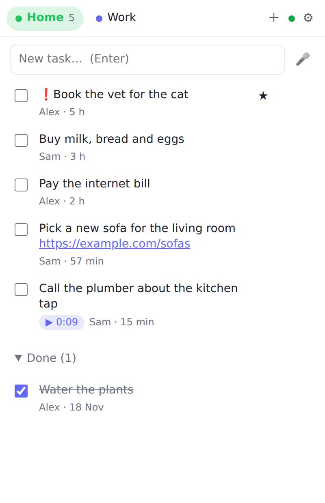
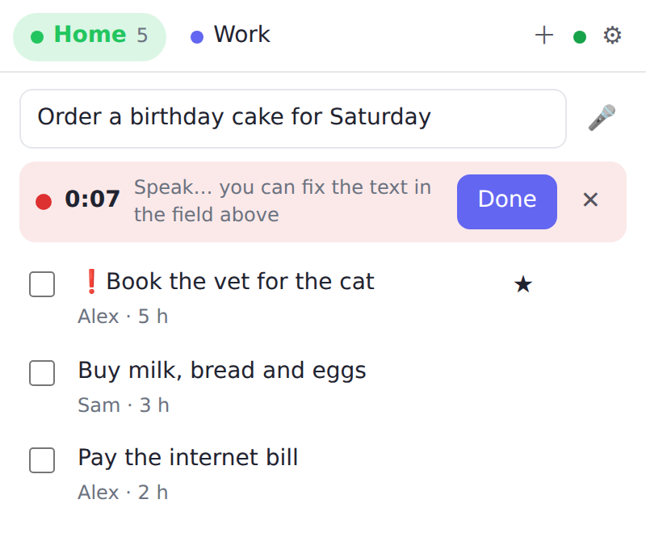
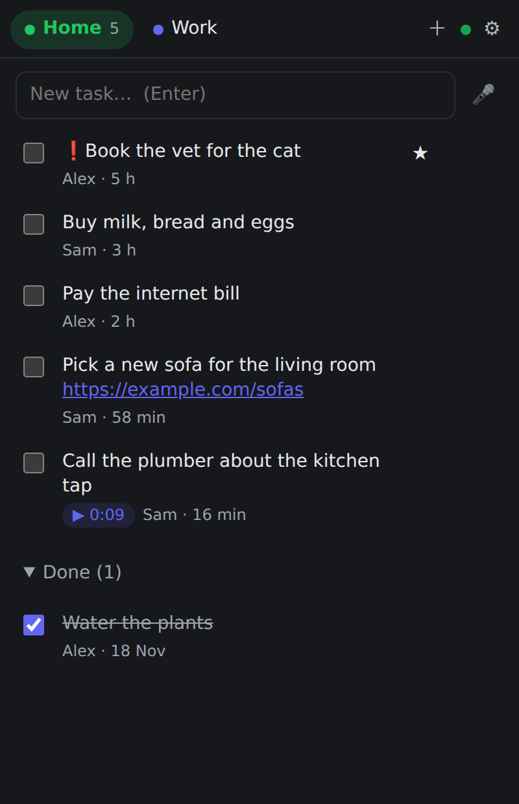

# data-box

A tiny self-hosted shared to-do list for a small team: a Chrome side panel with
lists, voice notes and live updates, backed by a single Go binary.

| | | |
|---|---|---|
|  |  |  |

## How it works

```
Chrome extension ──HTTPS + token──►  data-box server (Go, one binary)
  side panel        ◄── live events ──  SQLite + audio/ folder
  🎤 voice notes                         optional speech-to-text ──► OpenAI-compatible API
  right-click → task
```

- **Server** (`server/`) — one binary, no external services: lists and tasks in SQLite,
  recordings as files. Changes reach every open panel immediately (Server-Sent Events).
  Done tasks stay visible for 7 days and are deleted with their recordings after 30.
- **People** — everyone has their own token: the lists are shared, and each task shows who
  added it. Tokens can be revoked.
- **Extension** (`extension/`) — Chrome / Arc / Brave / Edge, plain JavaScript, no build step:
  - lists as tabs, add with Enter, ☆ important, ✎ edit or move to another list, delete;
  - 🎤 voice note: the audio is saved and attached to the task (▶ on the card). Type the text
    while recording, or leave it empty and the server transcribes it (if configured).
    Chrome's own speech recognition (sends audio to Google) is off by default and can be
    turned on in settings;
  - right-click a page, link or selection → “Add to tasks” (with a link back to the page);
  - open-task count on the toolbar icon; Alt+Shift+T opens the panel;
  - English UI, Russian when the browser language is Russian.

## Run locally

```bash
cd server && go build -o ../bin/data-box . && cd ..
export DATA_BOX_DIR=$PWD/data          # database and recordings
bin/data-box token create Alex         # prints the token once
bin/data-box serve                     # http://127.0.0.1:8790
bin/data-box ls                        # lists and tasks in the terminal
```

In the extension use `http://127.0.0.1:8790` (plain http is allowed only for localhost).

## Deploy

```bash
cp env.example .env                                     # set DOMAIN (and TRANSCRIBE_* if wanted)
mkdir -p data && sudo chown 10001:10001 data && sudo chmod 700 data
docker compose up -d --build                            # data-box + Caddy (Let's Encrypt HTTPS)
docker compose exec server data-box token create Alex
docker compose exec server data-box token list          # / token revoke Alex
```

No domain? `1-2-3-4.sslip.io` (your IP with dashes) works.

## Install the extension

1. `chrome://extensions` → enable Developer mode → “Load unpacked” → the `extension/` folder.
2. Click the data-box icon → ⚙ → server address and your token → Save.
   Chrome asks for access to that address — the only site the extension can reach.
3. The first 🎤 opens a tab asking for the microphone: a side panel cannot show that prompt itself.

## Security

- The token is sent only in the `Authorization` header, never in a URL, so it does not end up
  in logs, caches or shared links. The server stores only its SHA-256; a revoked token stops
  working at once, and an open event stream is closed within 25 seconds.
- The extension sends the token only to `https://` (or `http://localhost`) and can reach only
  your server's address. Server data is rendered as text only (no `innerHTML`); links are
  `http(s)` only; the context menu sends only `http(s)` page addresses.
- Recordings are served only as audio from an allow-list of formats, with `nosniff`,
  `Content-Disposition: attachment` and `CSP: sandbox`, so an uploaded “recording” can never
  open as a page.
- List and task ids are never reused (AUTOINCREMENT), so a late transcript cannot land in a
  different note. Edits change only the fields sent, in one statement; deleting a list is one
  transaction.
- Limits:

  | | |
  |---|---|
  | JSON request / task / list name | 64 KB / 4000 characters / 100 characters |
  | one recording | 25 MB |
  | all recordings on disk | `AUDIO_MAX_MB`, default 2048 |
  | transcription | 2 at a time (+8 queued), `TRANSCRIBE_DAILY_MINUTES` per day, default 120 |
  | event streams | 200 in total, 10 per user |
  | slow clients | 30 s for a request body (3 min for a recording upload) |

- Transcription is enabled only by the `TRANSCRIBE_*` variables and sends audio to the provider
  you choose; `TRANSCRIBE_URL` must be `https://` (http only for localhost / private networks).
- Files: data folder `700`, database and recordings `600`.
- Docker: both containers run with a read-only filesystem, no capabilities (Caddy keeps only
  `NET_BIND_SERVICE`) and `no-new-privileges`; the server runs as its own user and only Caddy
  (HTTPS, HSTS) is exposed.
- All members are equal: any token can delete any task or list. Back up the `data/` folder
  (`data-box.db` and `audio/`).

## Development

```bash
cd server
go test ./...                                   # or with Docker:
docker run --rm -v "$PWD":/src -w /src golang:1.27-alpine go test ./...
```

## API

Every request needs `Authorization: Bearer <token>`.

```
GET    /api/me                    {name, transcribe}
GET    /api/lists                 [{id, name, color}]
POST   /api/lists                 {name, color?: "#rrggbb"}
PATCH  /api/lists/{id}            {name?, color?}
DELETE /api/lists/{id}            with its tasks; the last list cannot be deleted
GET    /api/tasks                 open + done in the last 7 days
POST   /api/tasks                 JSON {text, list_id?, pri?} or multipart: text, list_id, pri, audio, audio_sec
PATCH  /api/tasks/{id}            {text?, list_id?, pri?, done?}
DELETE /api/tasks/{id}
GET    /api/tasks/{id}/audio      the recording
GET    /api/events                event stream (text/event-stream): {"kind":"task"|"list","id":N}
```
